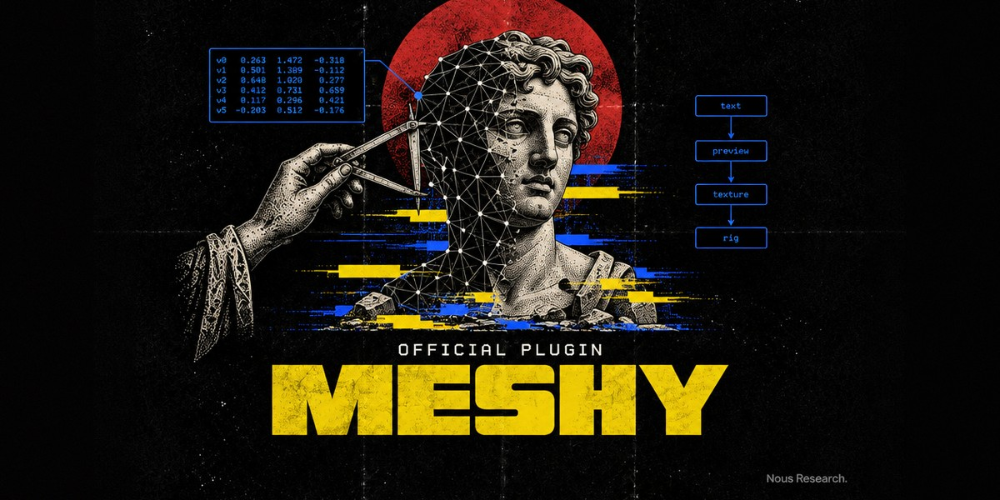

<p align="center"></p>

# Meshy

> Part of [Hermes Official Plugins](../README.md), Nous Research's official plugins for Hermes Agent.

Make 3D models from Hermes with [Meshy](https://www.meshy.ai): text or image to 3D,
texturing, remeshing, rigging, animation, format conversion, real-world resizing, UV
unwrapping, 2D concept images, and 3D-print preparation (printability analysis and repair,
multicolor 3MF, splitting into printable parts, slicer handoff, Creative Lab products).

This is a portable [Agent Plugins v1](https://agent-plugins.org) package. One install ships:

- `mcp.json`: Meshy's first-party MCP server
  ([meshy-dev/meshy-mcp-server](https://github.com/meshy-dev/meshy-mcp-server), MIT),
  launched as `npx -y @meshy-ai/meshy-mcp-server@0.6.4` over stdio for every new session
  while the plugin is enabled. No `mcp_servers` edit in config.yaml.
- `skills/meshy-3d/`: a workflow skill. It carries the server's own routing rules (cost
  confirmation, never re-creating an uncertain task, choosing the output format first, the
  scenario playbooks), because Hermes does not pass MCP server instructions to the model, plus
  a tool table generated from a live `tools/list`.

## Install

```bash
hermes plugins install meshy        # from the Nous plugin catalog
hermes plugins enable meshy
```

Then add your Meshy API key to the Hermes profile's `.env` (`~/.hermes/.env`, or
`~/.hermes/profiles/<name>/.env`):

```bash
MESHY_API_KEY=msy_...
```

Create the key at meshy.ai → Settings → API. API keys need a Pro plan or above. Start a new
Hermes session and ask, for example, "Make a low-poly treasure chest for Godot" or "Turn
~/photos/mug.jpg into a 3D model and get it ready to print at 10 cm".

Requirements: Node.js 18+ with `npx` on PATH. The first start downloads the pinned package
into npm's cache.

## Spending credits: approval

Most Meshy tools spend credits (5–62 per call; the skill's `references/tools.md` lists the
prices). The plugin marks the server `trust: untrusted`, so Hermes asks before every
write-capable call (creates, downloads, cancels) with Allow once / Allow for this session /
Deny. Read-only tools (balance, usage, task status and lists, the animation library, slicer
detection) run without a prompt. The skill also tells the agent to state the cost and get your
yes before any paid call. Unattended runs (cron, `hermes chat -q`, a gateway with no approver)
cannot approve, so paid calls are refused there.

To skip the prompts, override the server in `config.yaml` with the same name. A config entry
replaces the plugin's, trust included, so keep the pinned command:

```yaml
mcp_servers:
  meshy:
    command: npx
    args: ["-y", "@meshy-ai/meshy-mcp-server@0.6.4"]
    env:
      MESHY_API_KEY: ${MESHY_API_KEY}
```

## Where files go

`meshy_download_model` saves to the absolute `save_to` path the agent passes (the skill asks
it to always pass one). Without it, the server writes under `meshy_output/` in its working
directory, which this plugin sets to its own data directory
(`~/.hermes/plugin-data/agent-plugin-meshy-<hash>/meshy_output/`), not your project.

## Tools

28 tools (about 19K tokens of schemas), loaded on demand through Hermes' tool search, so they
cost nothing in the prompt until used. Hermes exposes them as `mcp__meshy__<tool>`:

Generation: `meshy_text_to_3d`, `meshy_text_to_3d_refine`, `meshy_image_to_3d`,
`meshy_multi_image_to_3d`, `meshy_text_to_image`, `meshy_image_to_image`.
Post-processing: `meshy_remesh`, `meshy_retexture`, `meshy_convert`, `meshy_resize`,
`meshy_uv_unwrap`.
Characters: `meshy_rig`, `meshy_animate`, `meshy_text_to_motion`, `meshy_list_animations`.
Printing: `meshy_analyze_printability`, `meshy_repair_printability`,
`meshy_process_multicolor`, `meshy_auto_split`, `meshy_send_to_slicer`, `meshy_creative_lab`.
Tasks and account: `meshy_get_task_status`, `meshy_list_tasks`, `meshy_list_models`,
`meshy_download_model`, `meshy_cancel_task`, `meshy_check_balance`, `meshy_list_usage`.

## Privacy

- The server sends prompts, images you reference by path or URL, and models to Meshy's API
  (`api.meshy.ai`) under your key. It sends no analytics of its own; requests carry a
  `meshy-mcp-server/<version>` user agent.
- Hermes passes MCP servers a filtered environment; this server gets only `MESHY_API_KEY`
  from your profile, filled in when the server starts.

## Why local and not a hosted URL

Meshy publishes this server only as a local stdio package and offers no hosted MCP endpoint.
A local server is also what makes local file inputs (`file_path`), downloads to disk, and
slicer detection work.

## Version pinning

`mcp.json` pins `@meshy-ai/meshy-mcp-server@0.6.4` (published 2026-10-13). Bumping it is a
commit here followed by a reviewed SHA bump in the
[hermes-agent plugin catalog](https://github.com/NousResearch/hermes-agent/tree/main/plugin-catalog).
`@latest` is deliberately not used.

## Attribution

The MCP server and the workflow rules the skill carries are by Meshy AI
([meshy-dev/meshy-mcp-server](https://github.com/meshy-dev/meshy-mcp-server), MIT,
Copyright (c) 2026 Meshy AI). Meshy is a product of Meshy AI. Packaging and skill: Nous
Research, MIT.
